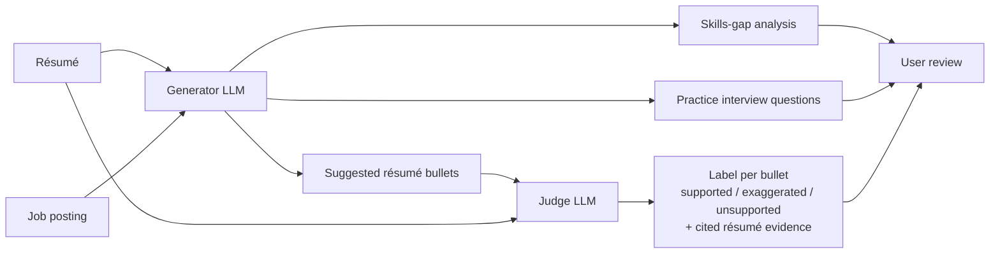

# FitCheck AI

**An LLM-powered job application assistant with AI-assisted claim verification**

MS AAI 530 (LLM Engineering) Final Team Project, Team 5

| | |
|---|---|
| **Team** | Gerek Jordan, Nathan Butcher, Nicole Rowley |
| **Status** | Planning. Sections marked `TBD` will be filled in as development progresses. |
| **AI use** | AIAS Level 4: AI tools are used intentionally and documented throughout development. |

---

## Table of Contents

1. [Project Purpose and Intended Users](#project-purpose-and-intended-users)
2. [How It Works](#how-it-works)
3. [LLM Model and API](#llm-model-and-api)
4. [Prompt Customization](#prompt-customization)
5. [Claim Verification (Safety and Evaluation Feature)](#claim-verification-safety-and-evaluation-feature)
6. [Repository Structure](#repository-structure)
7. [Required Tools and Services](#required-tools-and-services)
8. [Setup](#setup)
9. [Usage](#usage)
10. [Data](#data)
11. [Testing and Evaluation](#testing-and-evaluation)
12. [Known Limitations](#known-limitations)
13. [Responsible Use](#responsible-use)
14. [AI-Assisted Development](#ai-assisted-development)
15. [Reviewing This Project](#reviewing-this-project)
16. [Team and Contributions](#team-and-contributions)
17. [Acknowledgments](#acknowledgments)

---

## Project Purpose and Intended Users

**The problem.** Tailoring a résumé to a specific job posting is slow, and students and early-career job seekers often cannot tell which of their experiences matter for a given role. General-purpose LLM tools can help, but they tend to overstate or invent qualifications, and a fabricated claim on a résumé can cost an applicant an offer.

**Intended users.** Students and early-career job seekers.

**What FitCheck AI does.** The user provides a résumé and a job posting. The application returns:

- A **skills-gap analysis** comparing the résumé to the posting
- **Tailored résumé bullet suggestions**
- **Practice interview questions** for the role

**What makes it different.** Every suggested bullet is checked by a second LLM acting as a judge. The judge compares the bullet to the original résumé, labels it `supported`, `exaggerated`, or `unsupported`, and cites the résumé text it relied on. Flagged bullets are shown to the user for review before use.

**Anticipated value.** Faster, more targeted applications, with a built-in check that keeps suggestions grounded in what the applicant has actually done.

## How It Works



1. **Input.** The user supplies résumé text and job posting text.
2. **Generation.** A generator LLM, guided by a customized system prompt, returns structured JSON containing the gap analysis, bullet suggestions, and interview questions.
3. **Verification.** A judge LLM receives each suggested bullet with the original résumé and returns a label and the supporting résumé excerpt.
4. **Human review.** The user sees all outputs with the judge's flags and decides what to keep. Nothing is submitted anywhere on the user's behalf.

## LLM Model and API

| Role | Model / service | Why it was chosen |
|---|---|---|
| Generator | `TBD` | `TBD` |
| Judge | `TBD` | `TBD` |

The LLM is integrated through a commercial API. Model names, versions, and parameters (temperature, max tokens) will be recorded here and in `docs/` once selected, along with the reasoning for the choice.

## Prompt Customization

FitCheck AI goes beyond a single prompt by using:

- **System prompts** that define the role, the audience, and content boundaries for the generator and the judge
- **Structured JSON output formats** so results can be parsed, displayed, and scored
- **Reusable prompt templates** with slots for résumé and posting text
- **Versioned prompts**, so multiple prompt versions can be compared on the same test set

All prompts live in [`prompts/`](prompts/). Prompt iterations, the reasons for each revision, and the observed effects are recorded in the Prompt and Testing Appendix (`docs/prompt_testing_appendix.md`).

## Claim Verification (Safety and Evaluation Feature)

This is the project's feature beyond basic prompting. It serves as both a safety feature (output validation, source verification, human review) and an evaluation feature.

| Label | Meaning |
|---|---|
| `supported` | The bullet is backed by text in the original résumé |
| `exaggerated` | The bullet is based on résumé content but overstates scope, impact, or skill level |
| `unsupported` | The bullet has no basis in the résumé |

For each bullet, the judge also returns the résumé excerpt it relied on, so the user can confirm the judgment directly instead of trusting the label.

Because the judge is itself an LLM, its labels are validated against human labels on a hand-annotated gold set (see [Testing and Evaluation](#testing-and-evaluation)).

## Repository Structure

> Planned layout. This section will be updated to match the final repository.

```
.
├── README.md
├── requirements.txt            # Python dependencies
├── .env.example                # Required environment variables (no real keys)
├── .gitignore
├── src/                        # Application source code
│   ├── app.*                   # User interface / entry point (TBD)
│   ├── generator.py            # Gap analysis, bullets, interview questions
│   ├── judge.py                # Claim verification
│   └── schemas.py              # JSON output schemas
├── prompts/                    # System prompts and templates, by version
├── data/
│   ├── samples/                # Sample résumé and job posting inputs
│   └── test_set/               # The 40 evaluation pairs and gold annotations
├── evaluation/
│   ├── run_eval.py             # Runs the test set against a prompt version
│   └── results/                # Scores, judge-vs-human agreement, comparisons
├── outputs/                    # Selected model outputs
├── docs/
│   ├── project_report.*        # Written project documentation
│   ├── prompt_testing_appendix.md
│   ├── ai_use_ethical_reflection.md
│   └── screenshots/            # Screenshots and demonstration materials
└── notebooks/                  # Exploration and analysis notebooks
```

## Required Tools and Services

- Python `TBD` (version)
- An API key for the selected LLM provider (`TBD`)
- A Kaggle account, only if you want to rebuild the test set from the source datasets
- Dependencies listed in `requirements.txt`

## Setup

> These steps will be confirmed once the implementation is in place.

```bash
# 1. Clone the repository
git clone https://github.com/nicole-rowley-msaai/MS_AAI_530_LLM_Engineering_Final_Project.git
cd MS_AAI_530_LLM_Engineering_Final_Project

# 2. Create and activate a virtual environment
python -m venv .venv
source .venv/bin/activate        # Windows: .venv\Scripts\activate

# 3. Install dependencies
pip install -r requirements.txt

# 4. Configure environment variables
cp .env.example .env
```

Then open `.env` and add your own values:

| Variable | Description |
|---|---|
| `LLM_API_KEY` | API key for the LLM provider (`TBD`: final variable name) |
| `GENERATOR_MODEL` | Model used for generation |
| `JUDGE_MODEL` | Model used for claim verification |

**Security.** No API keys, credentials, or private data are committed to this repository. `.env` is listed in `.gitignore`. Do not add real résumés containing personal information.

## Usage

```bash
# Run the application (TBD: final command)
python src/app.py

# Run the evaluation on the test set (TBD: final command)
python evaluation/run_eval.py --prompt-version v1
```

A typical session:

1. Paste or upload a résumé.
2. Paste a job posting.
3. Review the skills-gap analysis, the suggested bullets with their verification labels and cited evidence, and the practice interview questions.
4. Edit or discard any bullet flagged `exaggerated` or `unsupported`.

Sample inputs are provided in `data/samples/` so the application can be tried without personal data.

## Data

This project evaluates an LLM application and does not train a model, so the data serves as a test set.

| Source | Description |
|---|---|
| [1.3M LinkedIn Jobs & Skills (2024)](https://www.kaggle.com/datasets/asaniczka/1-3m-linkedin-jobs-and-skills-2024) | About 1.3 million LinkedIn postings from 2024, with job details, description text, and extracted skills per posting |
| [Resume Dataset](https://www.kaggle.com/datasets/snehaanbhawal/resume-dataset) | 2,484 example résumés from livecareer.com in 24 job categories (ID, résumé text, résumé HTML, category) |

**Our sample:** 40 résumé and job-posting pairs across about 8 job categories, including strong matches, weak matches, and 5 deliberate mismatches.

| Subset | Pairs | How it is scored |
|---|---|---|
| Gold set | 10 | Hand-written annotations of true skill gaps and unsupported qualifications |
| Judge-scored set | 30 | Scored by the LLM judge, with human spot-checks on 8 |

The full source datasets are not redistributed here. Download them from Kaggle under their respective licenses.

## Testing and Evaluation

| Question | Method | Metric |
|---|---|---|
| Can the judge be trusted? | Compare judge labels to human labels on the gold set | Judge-human agreement rate |
| Are the outputs relevant? | Score outputs against the job posting across all 40 pairs | Relevance |
| Are the outputs stable? | Repeat runs on the same inputs | Consistency |
| Does the system invent qualifications? | Count bullets labeled `unsupported` | Unsupported-claim rate |
| Which prompts work best? | Run multiple prompt versions on the same test set | Side-by-side comparison of the metrics above |
| Does it behave sensibly on bad fits? | 5 deliberate résumé-posting mismatches | Qualitative review |

### Results

`TBD`. Results, prompt-version comparisons, and the improvements made in response to testing will be summarized here, with full artifacts in `evaluation/results/`.

## Known Limitations

- **The judge is an LLM.** It can mislabel bullets, and it may share blind spots with the generator. Its labels are an aid to review, not a guarantee.
- **Hallucination.** The generator can still produce exaggerated or unsupported claims. Verification reduces this risk but does not remove it.
- **Small test set.** 40 pairs across about 8 job categories cannot represent every field, seniority level, or résumé style.
- **Dataset fit.** Source résumés come from a single site and postings from a single platform and year, so results may not generalize.
- **Text only.** Résumé formatting, layout, and non-text content are not evaluated.
- **Not career advice.** Outputs are suggestions and do not predict hiring outcomes.

Additional failure modes found during testing will be added here.

## Responsible Use

- **Human oversight.** The user reviews every output. FitCheck AI never submits applications or edits a résumé on its own.
- **Transparency.** All suggestions are labeled as AI-generated, and judge labels are shown with the evidence behind them.
- **Privacy.** Résumés contain personal information. Résumé text is sent to a third-party LLM API, so users should remove details they do not want shared. The application does not store résumés (`TBD`: confirm against final implementation).
- **Honesty in applications.** The tool is designed to help users present real experience well, and flagged bullets should not be used without correction.
- **Bias and fairness.** LLM suggestions may reflect biases about roles, industries, or backgrounds. Performance across job categories is examined during evaluation.
- **Over-reliance.** A `supported` label means the judge found matching résumé text. The user is still responsible for the accuracy of their résumé.

A fuller discussion is in `docs/ai_use_ethical_reflection.md`.

## AI-Assisted Development

This project is AIAS Level 4, so AI tools are used throughout and documented. The reflection in `docs/ai_use_ethical_reflection.md` records:

- AI tools and models used
- How AI supported ideation, coding, prompt refinement, testing, and documentation
- How AI-generated suggestions were verified
- Which suggestions were modified or rejected
- How human judgment shaped final decisions

The team is responsible for understanding, modifying, evaluating, and explaining every component.

## Reviewing This Project

For instructors and reviewers, the course deliverables are located as follows:

| Deliverable | Location |
|---|---|
| Source code and configuration | `src/`, `requirements.txt`, `.env.example` |
| System prompts and templates | `prompts/` |
| Sample inputs and selected outputs | `data/samples/`, `outputs/` |
| Testing and evaluation artifacts | `evaluation/`, `data/test_set/` |
| Project documentation (report) | `docs/project_report.*` |
| Prompt and Testing Appendix | `docs/prompt_testing_appendix.md` |
| AI Use and Ethical Reflection | `docs/ai_use_ethical_reflection.md` |
| Screenshots and demo materials | `docs/screenshots/` |
| Recorded presentation and demo | `TBD` (link) |

To run the application yourself, follow [Setup](#setup) and [Usage](#usage). To review without running it, see the selected outputs in `outputs/` and the evaluation results in `evaluation/results/`.

## Team and Contributions

| Team member | Contributions |
|---|---|
| Gerek Jordan | `TBD` |
| Nathan Butcher | `TBD` |
| Nicole Rowley | `TBD` |

## Acknowledgments

- Kaggle dataset authors: asaniczka (1.3M LinkedIn Jobs & Skills, 2024) and Snehaan Bhawal (Resume Dataset)
- MS AAI 530, LLM Engineering
